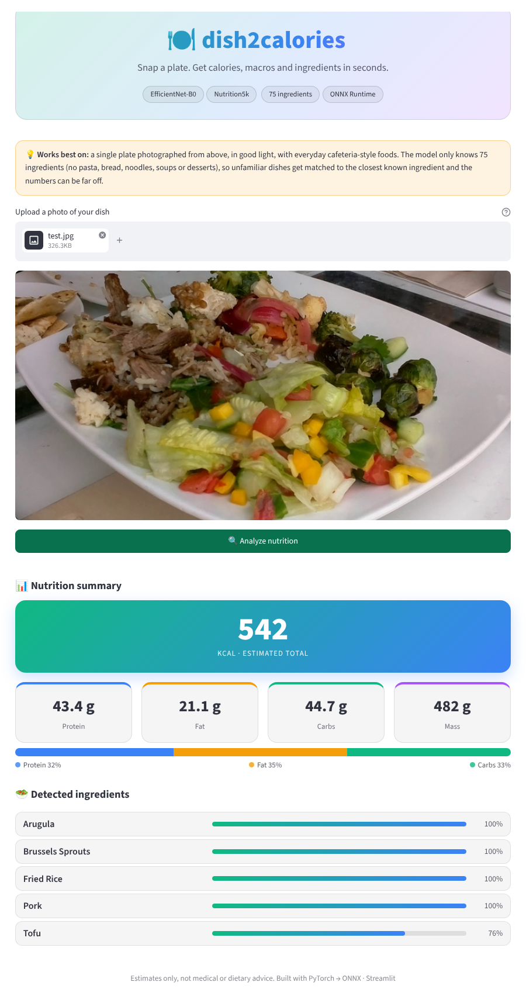
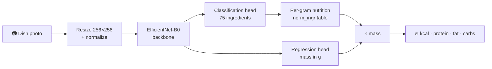

<div align="center">

# 🍽️ dish2calories

**Snap a plate. Get calories, macros and ingredients in seconds.**

A reimplementation of **Nutrition5k**: multi-label ingredient classification + mass regression on an EfficientNet-B0 backbone.

[](https://dish2calories.streamlit.app/)




[Quick Start](#-quick-start) · [How it works](#-how-it-works) · [Results](#-results) · [Limitations](#️-limitations-why-random-web-photos-can-look-wrong) · [Training](#-training--evaluation)

</div>

---

## ✨ Features

| | |
|---|---|
| 🥗 **Ingredient detection** | Multi-label classification over 75 Nutrition5k ingredients with per-ingredient confidence |
| ⚖️ **Mass estimation** | Predicts total dish mass in grams |
| 🔥 **Full nutrition** | Calories, protein, fat and carbs from detected ingredients × mass |
| 🪶 **Lightweight** | Serves on CPU with ONNX Runtime: no PyTorch or GPU needed |
| 🔌 **API + UI** | FastAPI endpoint and a Streamlit app, or one Docker container |

## 🧭 Pipeline



---

## 🚀 Quick Start

```bash
git clone https://github.com/AmirrrezaZ/dish2calories.git
cd dish2calories
docker compose up --build        # API on :8000, UI on :8501
```

Or without Docker:

```bash
pip install -r requirements.txt
streamlit run app.py
```

Call the API directly:

```bash
curl -F "file=@dataset/test.jpg" http://localhost:8000/predict
```

<details>
<summary>Example response</summary>

```json
{
  "total_protein": 43.4,
  "total_fat": 21.1,
  "total_carbs": 44.7,
  "total_calories": 542.2,
  "total_mass": 482.3,
  "labels_txt": ["arugula", "brussels sprouts", "fried rice", "pork", "tofu"],
  "labels_conf": [1.0, 1.0, 1.0, 1.0, 0.76],
  "mean_conf": 0.95,
  "top_candidates": [["arugula", 1.0], ["brussels sprouts", 1.0], ["fried rice", 1.0], ["pork", 1.0], ["tofu", 0.76]]
}
```

Interactive docs: <http://localhost:8000/docs>
</details>

---

## 📊 Dataset

The model is trained on **Nutrition5k**: ~5000 cafeteria dishes photographed from above and from side angles, with per-dish calories, macros, mass and ingredient lists.

- [Kaggle: Nutrition5k (side-angle images)](https://www.kaggle.com/search?q=nutrition5k)
- [GitHub: google-research-datasets/nutrition5k](https://github.com/google-research-datasets/nutrition5k)

The repo contains only the metadata CSVs in `dataset/`; download the images yourself to retrain.

---

## 🏗 Model Architecture

### 🔹 Google Baseline (Nutrition5k Original)
- **Backbone**: InceptionV2 pretrained on **JFT-300M** (~300M images, 18k classes, closed-source).  
- **Input**: 256×256 images, downsized & center-cropped.  
- **Optimization**: RMSProp (lr=1e-4, momentum=0.9, decay=0.9, epsilon=1.0).  
- **Multi-task heads**:
  - Shared 4096-dense layers.
  - Regression heads for calories, macronutrients, and mass.

### 🔹 Our Implementation (CalorieNet)
- **Backbone**: EfficientNet-B0 (ImageNet-pretrained).  
- **Input**: 256×256 images (normalized).  
- **Multi-task heads**:
  - **Classification Head**: Multi-label ingredient classification.
  - **Regression Head**: Mass prediction (grams) via 2-layer MLP (hidden_dim=64, dropout=0.3).
- **Mass Scaling**: `StandardScaler` normalization.  
- **Loss Function**:
  - BCEWithLogitsLoss → classification.  
  - MAE (L1) → regression.  
  - Weighted combination with **uncertainty weighting** ([Kendall et al., 2017](https://arxiv.org/abs/1705.07115)).

---

## 📈 Results

All MAE values are on the held-out test split. Calories are in kcal, mass in grams, and fat/carbs/protein in grams.

- **Direct**: nutrition is computed from the predicted ingredients and predicted mass (portion-dependent).
- **Portion Indep**: the per-gram prediction is scaled to the *ground-truth* mass, which isolates ingredient/macro error from mass error.

| Method                 | Calories MAE | Mass MAE | Fat MAE | Carb MAE | Protein MAE |
|------------------------|--------------|----------|---------|----------|-------------|
| Google (Portion Indep) | 24.1         | -        | 2.3     | 2.7      | 2.2         |
| Google (Direct)        | 70.6         | 40.4     | 5.0     | 6.1      | 5.5         |
| Ours (Direct)          | 67.66        | 28.56    | 4.61    | 6.41     | 4.52        |
| Ours (Portion Indep)   | 56.12        | -        | 4.04    | 4.79     | 3.94        |

Ingredient classification (multi-label, micro-averaged):

| Accuracy | Precision | Recall | F1     |
|----------|-----------|--------|--------|
| 0.8754   | 0.9614    | 0.9503 | 0.9558 |

---

## 🔍 How It Works
The dish2calories model's methodology enhances interpretability through transparent ingredient classification, mass regression, and nutritional calculations, while being more lightweight than Google's baseline by using EfficientNet-B0 and only two task heads (classification and regression) compared to Google's four.
The classification head takes the features from EfficientNet-B0 and predicts which ingredients are present.  
This is a multi-label classification task, meaning the model can predict multiple ingredients at once (e.g., a dish might have chicken and rice).  

The regression head also uses the features from EfficientNet-B0 to predict the total mass of the dish in grams.  

The model uses a table called `norm_ingr`, which lists the nutritional content per gram for each ingredient. For example (illustrative values):
- Chicken: 0.27 g protein, 0.04 g fat, 0 g carbs per gram.
- Rice: 0.03 g protein, 0.003 g fat, 0.28 g carbs per gram.

The model calculates the per-gram nutrition of the dish by combining the predicted ingredients. There are two ways it can do this:
- **Binary Mode**: If an ingredient is predicted (e.g., chicken and rice), it takes the average of their per-gram nutrition.
- **Probabilistic Mode**: Uses the confidence scores (e.g., 80% chicken, 60% rice) to weigh the contribution of each ingredient's nutrition. Higher-confidence ingredients contribute more to the average.

For example, if the dish is predicted to have chicken and rice, the per-gram nutrition is (binary mode):
- Protein: (0.27 + 0.03) / 2 = 0.15 g per gram.
- Fat: (0.04 + 0.003) / 2 ≈ 0.02 g per gram.
- Carbs: (0 + 0.28) / 2 = 0.14 g per gram.

The total nutrition is calculated by multiplying the per-gram values by the predicted mass. If mass = 200 g:
- Total protein = 0.15 × 200 = 30 g.
- Total fat = 0.02 × 200 ≈ 4 g.
- Total carbs = 0.14 × 200 = 28 g.

Calories are calculated using the standard Atwater formula:
- Calories = (4 × protein) + (9 × fat) + (4 × carbs).
- Using the example above: (4 × 30) + (9 × 4) + (4 × 28) = 120 + 36 + 112 = **268 kcal**.

**Output Example**  
The model returns a dictionary with:
- Total Protein: e.g., 172g.  
- Total Fat: e.g., 31g.  
- Total Carbs: e.g., 28g.  
- Total Calories: e.g., 1079 calories.  
- Total Mass: e.g., 200g.  
- Labels: List of detected ingredients (e.g., ["chicken", "rice"]).  
- Confidence Scores: How sure the model is about each ingredient (e.g., [0.8, 0.6]).  
- Mean Confidence: Average confidence across detected ingredients.  

For a single image, this is returned via the FastAPI endpoint or displayed in the Streamlit UI.

---

## 🗂 Project Structure

| Path | Purpose |
|------|---------|
| `app.py` | Streamlit UI |
| `inference.py` | FastAPI server (`/`, `/health`, `/predict`) |
| `onnx_predictor.py` | Lightweight ONNX Runtime inference + nutrition calculation (used by the app and API) |
| `predict.py` | PyTorch `CalorieNetPredictor` (used for evaluation) |
| `export_onnx.py` | Converts the `.pth` checkpoint to `.onnx` |
| `models.py`, `loss.py` | CalorieNet model and multi-task loss |
| `dataset_loaders.py` | Nutrition5k data loading and splits |
| `main.py`, `train.py` | Training entry point and loop |
| `evaluate.py`, `logs_visualizer.py` | Metrics and training-curve plots |
| `weights/` | Trained checkpoint (`efficientnet_b0.pth`) and exported `efficientnet_b0.onnx` |
| `configs/dataset_info.json` | Class index and per-gram ingredient nutrition table |
| `dataset/` | Metadata CSVs (images are **not** included – download them, see Dataset) |
| `service.py` | Model loading + result formatting shared by the UI and the API |
| `requirements*.txt` | `requirements.txt` (app), `-api` (FastAPI), `-train` (PyTorch, training/export) |
| `Dockerfile`, `docker-compose.yml`, `start.sh` | Container setup |

---

## ⚙️ Installation & Usage

### 🔹 Docker Compose

```bash
docker compose up --build
```

* FastAPI: [http://localhost:8000](http://localhost:8000)
* Streamlit: [http://localhost:8501](http://localhost:8501)

**Tips**

* Run in background: `docker compose up --build -d`
* Stop & clean up: `docker compose down`
* Single container with both API and UI: `docker build -t dish2calories . && docker run -p 8501:8501 dish2calories`

Inference runs on **ONNX Runtime (CPU)**, so no GPU, CUDA or PyTorch is needed in the image.

### 🔹 Running Locally (Without Docker)

```bash
python -m venv .venv && source .venv/bin/activate
pip install -r requirements.txt     # Streamlit + ONNX Runtime (small, no PyTorch)
streamlit run app.py                # runs the model in-process, no API needed
```

To also run the REST API: `pip install -r requirements-api.txt && python inference.py`.

The UI has two modes: if the `API_URL` environment variable is set it calls that FastAPI server (this is what Docker Compose does); otherwise it loads the ONNX model directly. Configuration is via environment variables – see [`.env.example`](.env.example): `API_HOST`, `API_PORT`, `API_URL`, `API_RELOAD`.

### 🔹 Live Demo

Hosted on Streamlit Community Cloud: <https://dish2calories.streamlit.app/>. It runs `app.py` with the small `requirements.txt` (no PyTorch, unpinned versions) so installs are fast on any Python version.

### 🔹 Training & Evaluation

1. Download the Nutrition5k side-angle images and place them under `dataset/` next to the metadata CSVs (see [Dataset](#-dataset)).
2. Adjust hyper-parameters in the `config` dict at the top of `main.py` (image size, batch size, epochs, learning rate, `num_workers`, …).
3. Install training dependencies and train:

   ```bash
   pip install -r requirements-train.txt   # PyTorch (CPU build; use pytorch.org for CUDA), torchmetrics, ...
   python main.py
   ```

   Checkpoints go to `weights/`, logs and loss curves to `logs/`, and class info to `configs/dataset_info.json`.
4. Export the trained checkpoint for the app (`weights/efficientnet_b0.onnx`):

   ```bash
   python export_onnx.py
   ```

5. Evaluate with `evaluate.py` (`NutritionEvaluator`) and plot curves with `logs_visualizer.py`.

The repo already ships trained weights (`.pth` for training/evaluation and `.onnx` for the app), so you do **not** need to train to run the app. Re-run `export_onnx.py` after retraining.

---

## ⚠️ Limitations: why random web photos can look "wrong"

This is not a pipeline bug: inference preprocessing matches training exactly, and the exported ONNX model matches the PyTorch one to ~1e-4. The errors come from what the model has seen:

- **Closed vocabulary.** Only 75 ingredients exist (see `configs/dataset_info.json`). There is no pasta, bread, noodles, soup, dessert or most non-Western foods, so a pasta-with-meatballs photo gets matched to the nearest known ingredient (e.g. `pork`) and carbs come out as 0.
- **Domain shift.** Nutrition5k is one cafeteria with a fixed camera, lighting and plate type. Stock photos, angled shots and heavy styling are out-of-distribution.
- **Mass from one image.** Without a depth sensor or scale reference, mass is a guess (~29 g MAE *on the dataset's own camera setup*).
- **Nutrition = ingredient average × mass.** Detected ingredients are weighted by confidence, not by how much of each is on the plate.
- Results are estimates for general interest, **not medical or dietary advice**.

The UI shows per-ingredient confidence and the model's other top candidates, and warns when confidence is low. For better real-world accuracy, retrain on a broader ingredient-labelled dataset and extend `norm_ingr`.

---

## 📚 References

* Nutrition5k Paper: [arXiv:2103.03375](https://arxiv.org/abs/2103.03375)
* Multi-task Loss: [arXiv:1705.07115](https://arxiv.org/abs/1705.07115)
* Blog: *Predicting Nutritional Contents of Meals Using Deep Learning*
* Dataset: [Kaggle: Nutrition5k](https://www.kaggle.com/search?q=nutrition5k) | [GitHub: Nutrition5k](https://github.com/google-research-datasets/nutrition5k)

---

## 📜 License

This project is licensed under the **MIT License**.
See the [LICENSE](LICENSE) file for details.

## 📝 Citation

```bibtex
@inproceedings{thames2021nutrition5k,
  title     = {Nutrition5k: Towards Automatic Nutritional Understanding of Generic Food},
  author    = {Thames, Quin and Karpur, Arjun and Norris, Wade and Xia, Fangting and Panait, Liviu and Weyand, Tobias and Sim, Jack},
  booktitle = {CVPR},
  year      = {2021}
}
```
